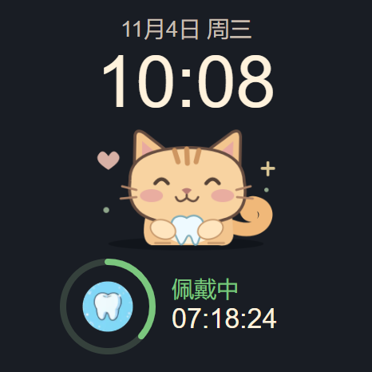
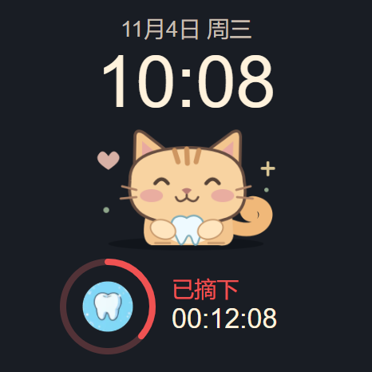

# 猫咪陪你 · BlueOS 表盘

表盘工程，面向 vivo WATCH GT（WA2456C / BlueOS 3.0），设计宽度 466。显示本地时间、日期、星期，以及牙套佩戴进度、状态与时间。点击猫咪或底部圆环区域打开已经安装的牙套计时器。





应用跳转地址：`hap://app/com.personal.alignertimer/pages/Demo`。牙齿图标位于圆环中心，右侧显示状态与时间；绿色显示当天累计佩戴时长，红色显示本次摘下时长，圆环始终表示当天佩戴进度。点击入口只打开应用。

应用通过 BlueOS `exchange` 的 `vendor` 空间发布最小状态，表盘读取后按时间戳计算实时显示，历史记录保留在应用本地。两个包需要使用同一签名；本机调试包均使用相同的 SDK 调试证书。共享键为 `com.personal.alignertimer.status.v1`。系统重启会清除共享数据，表盘此时显示“点此同步”，打开一次牙套应用即可恢复。

## 构建和安装

保留整个仓库目录结构，在 BlueOS Studio 中打开本目录，使用方形手表目标编译。共享状态计算复用仓库的 `src/watchface-state.js`。也可以在本目录终端执行：

```powershell
node "D:\BlueOSStudio\resources\app\extensions\blueos-debugger\node_modules\blueos-pack\bin\index.js" build --device-type watch-square
```

已使用 blueos-pack 1.0.12-beta.13 编译，表盘版本 1.0.1，调试包为 `dist/watch-square/debug/com.personal.alignercatwatchface.debug.1.0.1.rpk`。

先更新牙套计时器到 1.0.3 或更新版本，打开一次应用，再通过 Studio 安装本表盘调试包，长按手表当前表盘，在表盘选择列表中查找“猫咪陪你”。真机是否接受第三方表盘安装、状态共享与应用深链接是否成功，需要在手表上验证。

`300102` 是本工程本地开发使用的表盘 ID。若发布到表盘商店，应使用官方分配的表盘 ID，同步更新 manifest、表盘目录和资源路径。

猫咪为本项目原创矢量图，源文件为 `art/cat.svg`。打包使用 PNG 图片，以兼容手表图片渲染。表盘仅在前台按秒更新时间，每 15 秒读取一次共享状态，退出和隐藏时清理计时任务，并忽略延迟返回的旧请求。
